  

  

  
  
  
  
  

---

### 👋 About

I'm a **Computer Engineer and Software Architect** based in **Berlin**, building the open, interoperable data ecosystems behind the European automotive and manufacturing industries.

- 🏗️ **Chief Software Architect** at [Catena-X Automotive Network e.V.](https://catena-x.net)
- 🚀 **Project Lead & Committer** of [Eclipse Tractus-X](https://github.com/eclipse-tractusx), the open-source reference implementation of Catena-X
- 🏭 **TP4.E Architecture** in the [Factory-X](https://factory-x.org) consortium
- 🔐 **Certified Network Defender** (EC-Council), with a background in cybersecurity & ethical hacking
- 🌍 Spanish 🇪🇸 · Portuguese 🇧🇷 · English 🇬🇧 · German 🇩🇪

---

### 🚀 Featured Projects

| Project | Description | |
|:--|:--|:--:|
| [**Industry Core Hub**](https://github.com/eclipse-tractusx/industry-core-hub) | The KIT / use-case speedway for onboarding to Catena-X dataspaces |  |
| [**Tractus-X SDK**](https://github.com/eclipse-tractusx/tractusx-sdk) | Dataspace & Industry Foundation middleware for building Tractus-X applications |  |
| [**Digital Product Pass**](https://github.com/eclipse-tractusx/digital-product-pass) | Reference implementation of the EcoPass KIT for Digital, Battery & Transmission Passports |  |
| [**Tractus-X Test Lab**](https://github.com/eclipse-tractusx/tractusx-testlab) | Dataspace-native testing framework automating test executables on top of the SDK |  |

**Also contributing to:**
[eclipse-tractusx/tractusx-edc](https://github.com/eclipse-tractusx/tractusx-edc) ·
[eclipse-tractusx/sldt-digital-twin-registry](https://github.com/eclipse-tractusx/sldt-digital-twin-registry) ·
[eclipse-tractusx/tractus-x-umbrella](https://github.com/eclipse-tractusx/tractus-x-umbrella) ·
[eclipse-edc/IdentityHub](https://github.com/eclipse-edc/IdentityHub) ·
[eclipse-basyx/basyx-python-sdk](https://github.com/eclipse-basyx/basyx-python-sdk) ·
[eclipse-tractusx/sig-architecture](https://github.com/eclipse-tractusx/sig-architecture) ·
[eclipse-tractusx/sig-security](https://github.com/eclipse-tractusx/sig-security)

---

### 🧭 Focus Areas

  
  
  
  
  
  
  

### 🛠️ Tech Stack

  
   
  

---

### 📊 GitHub Activity

  <picture>
    <source media="(prefers-color-scheme: dark)" srcset="./profile/stats-dark.svg" />
    
  </picture>
  <picture>
    <source media="(prefers-color-scheme: dark)" srcset="./profile/top-langs-dark.svg" />
    
  </picture>

  <picture>
    <source media="(prefers-color-scheme: dark)" srcset="./profile/contributions-dark.svg" />
    
  </picture>

